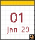

<p align="center">
  
</p>

<h1 align="center">DateReplicant</h1>

<p align="center">
  
  
  
</p>

DateReplicant is a small Haiku application and Deskbar replicant that displays
the day, month and year over a configurable background. It modernises Vlad B.'s
original Date 0.01 while retaining its settings format and application
signature. The untouched historical source is kept in
[`DateReplicant-Original`](DateReplicant-Original).

## Build

DateReplicant uses Haiku's standard `makefile-engine` and requires Haiku with
the development tools installed:

```sh
make
```

The resulting `DateReplicant` application can be launched normally. Use its
dragger to add the view to Deskbar.

## Configuration

On first launch, DateReplicant creates
`~/config/settings/Date_settings`. The file controls the AM and PM background
images, fonts, colours, positions, visibility and `strftime` format strings.
For example:

```text
Background_AM ""
Background_PM ""
FontDay "Courier10 BT" "Bold Italic" 20.1 150 50 60 0 "Off"
FontMonth "Courier10 BT" "Bold Italic" 10.1 150 50 60 0 "Off"
FontYear "Courier10 BT" "Bold Italic" 10.1 150 50 60 0 "Off"
PositionDay 14 10
PositionMonth 10 35
PositionYear 30 35
DayVisible "On"
MonthVisible "On"
YearVisible "On"
DayString "%d"
MonthString "%b"
YearString "%y"
```

Format strings use `strftime` syntax, so values such as `%A`, `%B` and `%Y`
are also supported. Changes are read when the application starts.

## Heritage

The bundled default background comes from the OBOS GUI prototype. The original
author credited Sergei Dolgov, Roman Kopko and Ilya Nedoluzhko, and can be
contacted at `_sl@mail.ru`.


